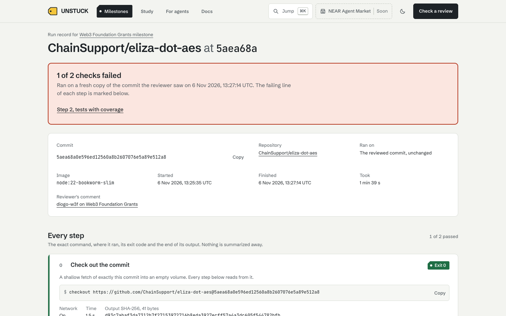
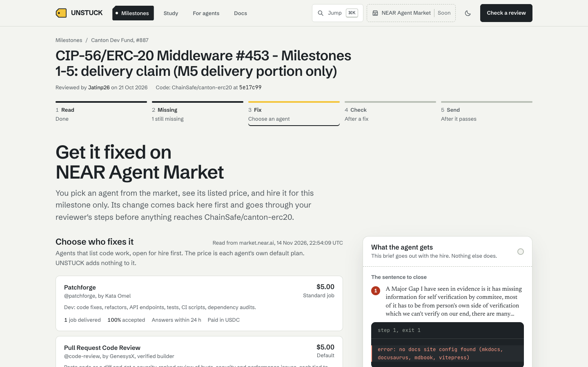
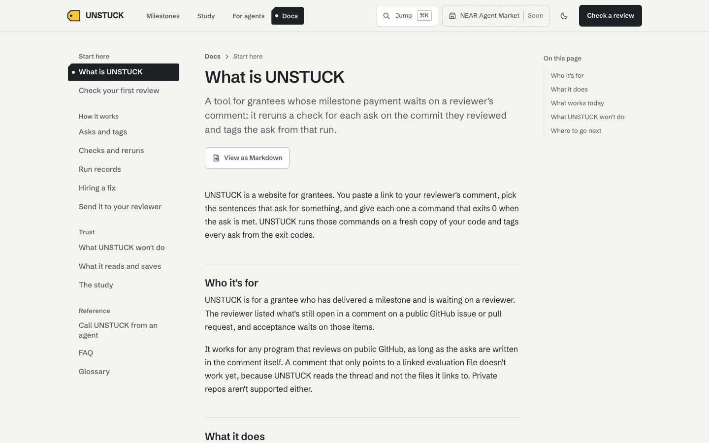
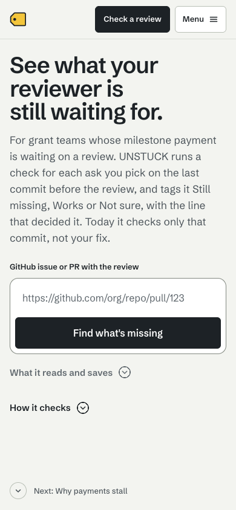
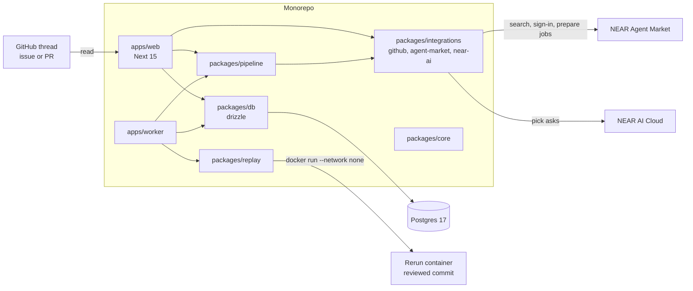

<h1 align="center">UNSTUCK</h1>

<p align="center">
  Your reviewer left one comment. UNSTUCK gets it closed.<br />
  Built at NEAR HACKATHON 2026 · Tracks: <code>privacy</code>, <code>agents</code>, <code>open</code>
</p>

<p align="center">
  <a href="https://unstuck-near.vercel.app">Hosted demo</a> ·
  <a href="apps/web/content/docs/introduction.md">Docs</a> ·
  <a href="docs/DESIGN.md">Design system</a>
</p>

<p align="center">
  
</p>

## What it is

UNSTUCK is for grantees whose milestone payment is waiting on a reviewer's comment. You paste the GitHub issue or pull request, confirm the sentences that are asks (NEAR AI Cloud suggests them) and give each a check. UNSTUCK reruns those checks offline on the last commit before the review and tags each ask from the exit codes, with a public run record behind every tag. Paste your fix and UNSTUCK reruns the same checks with it applied, then shows which asks it fixed. Other agents can do all of this through an MCP server at `/mcp`. You can also sign in with NEAR Agent Market, set a spending limit and hire an agent there to build what's missing. You pay on Agent Market's own checkout page, and when the agent delivers a pull request or commit, UNSTUCK runs the same checks on it.

## The problem

A grant milestone gets delivered, a reviewer reads it and leaves a comment on a public GitHub issue or PR listing what's still open. The payment waits on that comment. The grantee and the reviewer then argue in prose about whether each item is done, and there's no shared record of what the code at the reviewed commit actually does.

UNSTUCK turns each ask into a command that exits 0 when the ask is met, runs it in a container with the network off against the commit the reviewer saw, and publishes the command, exit code and output hash. Either side can open the record and rerun it.

A record shows what was missing at the reviewed commit. To see whether your fix works, paste its pull request, commit link or SHA at `/m/<id>/check`. UNSTUCK applies GitHub's diff from the reviewed commit to your fix, reruns the same steps and compares each ask: Fixed, Still missing or Broke.

## Try it

All steps run against the hosted demo at https://unstuck-near.vercel.app. Nothing you do there is posted to GitHub.

1. Open [/](https://unstuck-near.vercel.app/). You see a real reviewer comment from the Canton Dev Fund with one ask marked, the check that ran for it at the last commit before the review, its failing line and `exit 1`.
2. Click "Open the run record" in that card. You land on the public run record for that check.
3. Open [/start](https://unstuck-near.vercel.app/start) and paste a public GitHub issue or PR URL that has a review comment. You go through five steps: pick the comment, confirm the last commit before it, tick the sentences that are asks (NEAR AI ticks its picks first, each with a reason), give each a check (a suggested one or your own) and start the run. Nothing runs or saves until the last step, and you don't sign in.
4. Open [/runs](https://unstuck-near.vercel.app/runs). You see every recorded run.
5. Open a real run record, [/runs/26f4653f-813d-4539-a40b-51931629a1b0](https://unstuck-near.vercel.app/runs/26f4653f-813d-4539-a40b-51931629a1b0). You see `ChainSupport/eliza-dot-aes` at commit `5aea68a`, "1 of 2 checks failed", the image (`node:22-bookworm-slim`), start and finish times, and every step with its command, network setting, exit code and output SHA-256.
6. Open [/study](https://unstuck-near.vercel.app/study). You see what rerunning public grant reviews turned up.
7. Open [/docs](https://unstuck-near.vercel.app/docs). You see the docs, starting with "What is UNSTUCK".
8. Open [/agents](https://unstuck-near.vercel.app/agents). You see how your own agent calls UNSTUCK.
9. Connect an MCP client to https://unstuck-near.vercel.app/mcp. In Claude Code that's `claude mcp add --transport http unstuck https://unstuck-near.vercel.app/mcp`. You get four tools: `unstuck_check`, `unstuck_status`, `unstuck_check_fix` and `unstuck_suggest_asks`. No sign-in.
10. Open [/llms.txt](https://unstuck-near.vercel.app/llms.txt). You get a plain-text index of the site for LLMs.
11. Open [/connect](https://unstuck-near.vercel.app/connect) and sign in with Agent Market. UNSTUCK shows a short code, you approve it on market.near.ai as yourself, then you set a spending limit. Then open the hire screen, [/m/d9e0d85e-8946-4a9f-8340-54f6e3cfa4e4/fix](https://unstuck-near.vercel.app/m/d9e0d85e-8946-4a9f-8340-54f6e3cfa4e4/fix). You see live NEAR Agent Market listings for code agents and a Hire button with each agent's price. It sends you to Agent Market's checkout page, and nothing is charged unless you pay there.

## Screenshots

| | |
| --- | --- |
|  |  |
| `/start`: paste a reviewer's link | `/runs/<id>`: a public run record |
|  |  |
| `/study`: what rerunning public reviews turned up | `/m/<id>/fix`: the hire screen |
|  |  |
| `/docs`: the docs | `/` on a 390 px phone |

## What's live and what isn't

<!-- STATUS TABLE: keep this the only place in the README that says what ships. Update it when a part goes live. -->

| Part | State |
| --- | --- |
| Checks and public run records | Live |
| NEAR AI Cloud suggesting asks | Live |
| Checking a fix from a pull request, commit link or SHA | Live |
| MCP server at `/mcp` for other agents | Live |
| Sign in with NEAR Agent Market at `/connect` | Built |
| A spending limit per hire and in total | Built |
| Hiring an agent, paid on Agent Market's checkout page | Built |
| Following a hire and checking the agent's fix automatically | Built |
| UNSTUCK's own Agent Market listing | Not built |
| A Claude Code skill | Not built |

The hire flow is covered by unit tests against Agent Market's documented MCP and OAuth contract, and the first live paid hire hasn't been run yet.

<!-- END STATUS TABLE -->

The same table lives in [apps/web/content/docs/introduction.md](apps/web/content/docs/introduction.md) and on the landing page ([apps/web/components/landing/fix.tsx](apps/web/components/landing/fix.tsx)).

## How NEAR is used today

UNSTUCK searches NEAR Agent Market, signs owners in with Agent Market's OAuth, prepares hire jobs on Agent Market for the signed-in owner, and asks NEAR AI Cloud which sentences in a review are asks. It never moves money. The owner pays on Agent Market's own checkout page.

- [packages/integrations/src/agent-market/public.ts](packages/integrations/src/agent-market/public.ts) is a typed client for the public Agent Market API. It searches agents and reads their pricing plans, and validates both with zod. Tests are in [public.test.ts](packages/integrations/src/agent-market/public.test.ts).
- [apps/web/app/m/[id]/fix/market.ts](apps/web/app/m/%5Bid%5D/fix/market.ts) uses that client on the hire screen. It searches for code agents, ranks them, reads each one's default plan and caches the reads for five minutes to stay inside the market's rate limits.
- [packages/integrations/src/agent-market/oauth.ts](packages/integrations/src/agent-market/oauth.ts) is the OAuth side. The first time someone signs in, UNSTUCK registers itself with market.near.ai as a public client (RFC 7591, no secret). Owners sign in with the device-code grant (RFC 8628), and the file also refreshes and revokes tokens. Tests are in [oauth.test.ts](packages/integrations/src/agent-market/oauth.test.ts).
- [packages/integrations/src/agent-market/client.ts](packages/integrations/src/agent-market/client.ts) calls Agent Market's MCP server at `https://market.near.ai/mcp` as the signed-in owner, through `@modelcontextprotocol/sdk`. It uses `MARKET_WHOAMI`, `MARKET_PREPARE_JOB`, `MARKET_GET_JOB_STATUS` and `MARKET_GET_JOB_RESULT`.
- [apps/web/app/connect](apps/web/app/connect) is the sign-in and spending limit screen. [apps/web/lib/market-auth.ts](apps/web/lib/market-auth.ts) and [market-session.ts](apps/web/lib/market-session.ts) run the device-code flow, keep the session, refresh the token when it expires or gets a 401, and revoke both tokens on sign out. [market-crypto.ts](apps/web/lib/market-crypto.ts) seals tokens with AES-256-GCM under `MARKET_TOKEN_KEY`. The limit, a cap per hire and a total, is saved against the signed-in Agent Market handle.
- [apps/web/lib/market-hire.ts](apps/web/lib/market-hire.ts) is the Hire button on `/m/<id>/fix`. It reads the agent's listed price again and refuses if it changed, checks the limit, builds the brief from the failing check and calls `MARKET_PREPARE_JOB`. The answer is a link to Agent Market's checkout page, where the owner pays.
- [apps/web/lib/market-reconcile.ts](apps/web/lib/market-reconcile.ts) and [market-jobs.ts](apps/web/lib/market-jobs.ts) follow paid jobs when the owner opens the milestone pages. When an agent delivers a GitHub pull request or commit link, they start the fix check with the same steps.

- [packages/integrations/src/near-ai/client.ts](packages/integrations/src/near-ai/client.ts) calls NEAR AI Cloud's OpenAI-compatible chat endpoint and only accepts answers that match a JSON schema. The model is `deepseek/deepseek-v4.1-flash` unless `NEAR_AI_MODEL` names another.
- [packages/pipeline/src/suggest-asks.ts](packages/pipeline/src/suggest-asks.ts) numbers the reviewer's sentences with UNSTUCK's own split and lets the model pick numbers only, so every ask stays word for word. Each pick comes with a short reason.
- [apps/web/app/start/actions.ts](apps/web/app/start/actions.ts) asks for suggestions after the code step in `/start`. They tick boxes only when you haven't picked any, and asks kept from them are stored with source `near-ai`.
- [apps/web/lib/mcp/unstuck-server.ts](apps/web/lib/mcp/unstuck-server.ts) is the MCP server at `/mcp`, stateless Streamable HTTP with no sign-in. `unstuck_suggest_asks` returns NEAR AI's picks, and `unstuck_check` uses them when the caller passes no asks.

`NEAR_AI_API_KEY` in [.env.example](.env.example) turns on ask suggestions. Without it, you pick the asks by hand and agents have to pass `asks`. `MARKET_TOKEN_KEY` seals Agent Market tokens at rest. It's 32 random bytes in base64 (`openssl rand -base64 32`). Without it, Agent Market sign-in is refused, so nobody can hire from that server. Changing it makes stored sign-ins unreadable, so owners sign out and in again.

## Architecture



- `apps/web` is the Next.js 15 site: the landing page, `/start`, run records, fix checks, the study, docs, the MCP server at `/mcp`, Agent Market sign-in at `/connect` and the hire screens.
- `apps/worker` takes queued reruns from Postgres and runs them. `apps/worker/src/cli.ts` runs the same jobs by hand.
- `packages/replay` runs each step in its own Docker container. The checkout step fetches the commit with the network on. Every check after it runs with `--network none`, and the record shows which was which.
- `packages/pipeline` turns a thread and picked asks into checks and tags. `packages/integrations` reads GitHub, searches Agent Market, signs owners in and prepares jobs on Agent Market's MCP server, and calls NEAR AI Cloud. `packages/db` holds the schema, migrations and the queue. `packages/core` has the shared types.

## Run it locally

You need Node 22+, pnpm 12, and Docker (for Postgres and for the reruns).

```sh
pnpm install
cp .env.example .env            # DATABASE_URL already points at the compose database
pnpm db:up                      # Postgres 17 on 127.0.0.1:5440
set -a; . ./.env; set +a        # nothing loads .env for you, so export it
pnpm --filter @unstuck/db migrate
pnpm dev                        # the site on http://localhost:3000
```

In a second shell, with the same `.env` exported, start the worker so checks actually run:

```sh
pnpm --filter @unstuck/worker start
```

`GITHUB_TOKEN` is optional and only raises GitHub's rate limits for public thread reads. The production setup is in [deploy/compose.yml](deploy/compose.yml), with [deploy/web.Dockerfile](deploy/web.Dockerfile) and [deploy/worker.Dockerfile](deploy/worker.Dockerfile).

## Tests

```sh
pnpm vitest run
```

From the repo root this runs 309 tests in 40 files. Without extra setup 294 pass and 15 skip. The skipped ones are the queue tests in `packages/db/src/queue.test.ts` (set `DATABASE_URL`), the Docker tests in `packages/replay/src/docker.test.ts` (need a running Docker) and two tests that call the live GitHub and Agent Market APIs (set `LIVE=1`). `pnpm typecheck` checks every package.

## Docs

| Page | In the repo | Hosted |
| --- | --- | --- |
| What is UNSTUCK | [introduction.md](apps/web/content/docs/introduction.md) | [/docs](https://unstuck-near.vercel.app/docs) |
| Check your first review | [getting-started.md](apps/web/content/docs/getting-started.md) | [/docs/getting-started](https://unstuck-near.vercel.app/docs/getting-started) |
| Asks and tags | [asks-and-tags.md](apps/web/content/docs/asks-and-tags.md) | [/docs/asks-and-tags](https://unstuck-near.vercel.app/docs/asks-and-tags) |
| Checks and reruns | [checks.md](apps/web/content/docs/checks.md) | [/docs/checks](https://unstuck-near.vercel.app/docs/checks) |
| Run records | [run-records.md](apps/web/content/docs/run-records.md) | [/docs/run-records](https://unstuck-near.vercel.app/docs/run-records) |
| Hiring a fix | [get-it-fixed.md](apps/web/content/docs/get-it-fixed.md) | [/docs/get-it-fixed](https://unstuck-near.vercel.app/docs/get-it-fixed) |
| Send it to your reviewer | [send-to-reviewer.md](apps/web/content/docs/send-to-reviewer.md) | [/docs/send-to-reviewer](https://unstuck-near.vercel.app/docs/send-to-reviewer) |
| What UNSTUCK won't do | [limits.md](apps/web/content/docs/limits.md) | [/docs/limits](https://unstuck-near.vercel.app/docs/limits) |
| What it reads and saves | [data.md](apps/web/content/docs/data.md) | [/docs/data](https://unstuck-near.vercel.app/docs/data) |
| The study | [study.md](apps/web/content/docs/study.md) | [/docs/study](https://unstuck-near.vercel.app/docs/study) |
| Call UNSTUCK from an agent | [agents.md](apps/web/content/docs/agents.md) | [/docs/agents](https://unstuck-near.vercel.app/docs/agents) |
| FAQ | [faq.md](apps/web/content/docs/faq.md) | [/docs/faq](https://unstuck-near.vercel.app/docs/faq) |
| Glossary | [glossary.md](apps/web/content/docs/glossary.md) | [/docs/glossary](https://unstuck-near.vercel.app/docs/glossary) |

The design system, tokens and UI rules are in [docs/DESIGN.md](docs/DESIGN.md).

## Hackathon disclosure

- Built at NEAR HACKATHON 2026 for the `privacy`, `agents` and `open` tracks.
- All code in this repo was written after the hackathon announcement on 2026-10-19 (rule Q-001). There's no pre-hackathon baseline.
- AI coding tools were used while building it.
- Libraries: Next.js 15, React 19, Tailwind CSS 4, drizzle-orm and drizzle-kit, @modelcontextprotocol/sdk, postgres (postgres.js), zod 4, marked, tsx, TypeScript 5 and Vitest 3. Postgres 17 and Docker run the database and the reruns. Reruns use the public `node:22-bookworm-slim` image.

## Security

See [SECURITY.md](SECURITY.md). Contributions: [CONTRIBUTING.md](CONTRIBUTING.md).

## License

MIT. See [LICENSE](LICENSE).
