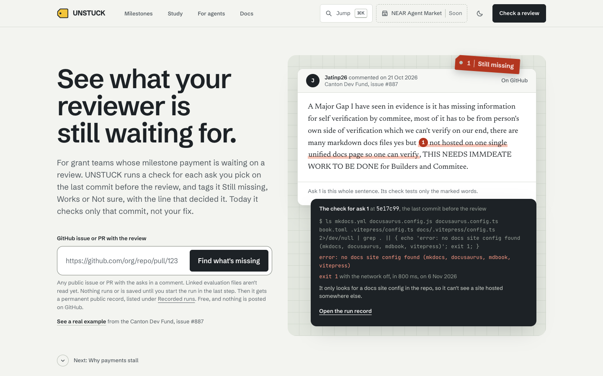
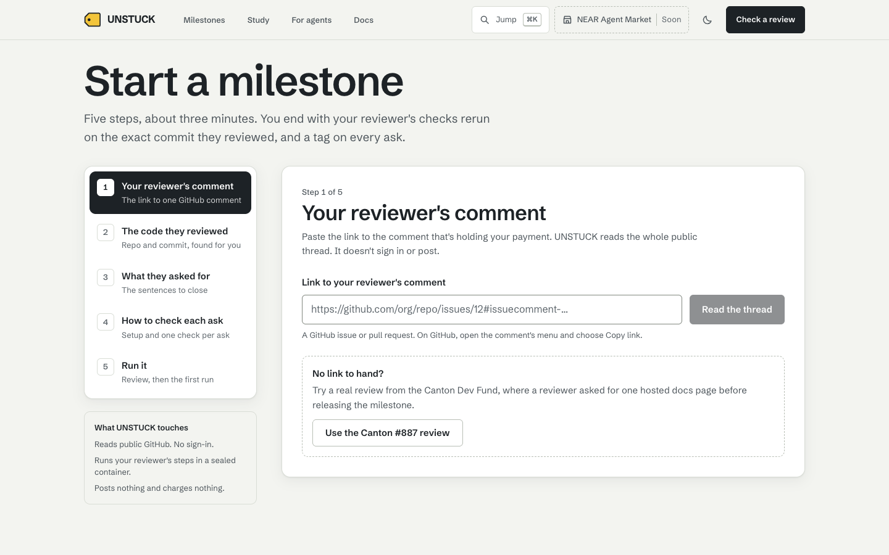
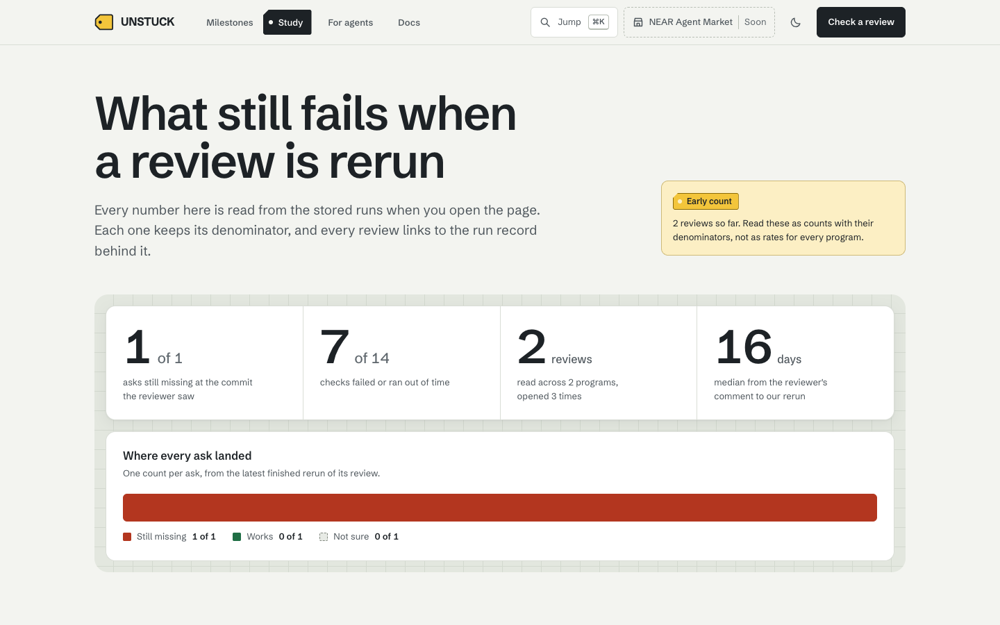
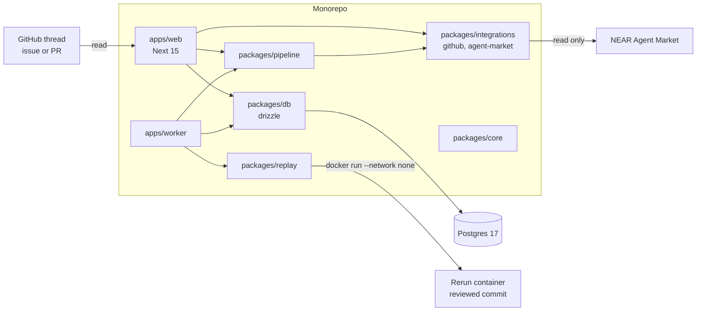

<h1 align="center">UNSTUCK</h1>

<p align="center">
  Your reviewer left one comment. UNSTUCK gets it closed.<br />
  Built at NEAR HACKATHON 2026 · Tracks: <code>agents</code>, <code>open</code>
</p>

<p align="center">
  <a href="https://unstuck-near.vercel.app">Hosted demo</a> ·
  <a href="apps/web/content/docs/introduction.md">Docs</a> ·
  <a href="docs/DESIGN.md">Design system</a>
</p>

<p align="center">
  
</p>

## What it is

UNSTUCK is for grantees whose milestone payment is waiting on a reviewer's comment. You paste the GitHub issue or pull request, pick the sentences that are asks and give each a check. UNSTUCK reruns those checks offline on the last commit before the review and tags each ask from the exit codes, with a public run record behind every tag. Hiring an agent on NEAR Agent Market to build what's missing is built but switched off, so nothing can be charged today.

## The problem

A grant milestone gets delivered, a reviewer reads it and leaves a comment on a public GitHub issue or PR listing what's still open. The payment waits on that comment. The grantee and the reviewer then argue in prose about whether each item is done, and there's no shared record of what the code at the reviewed commit actually does.

UNSTUCK turns each ask into a command that exits 0 when the ask is met, runs it in a container with the network off against the commit the reviewer saw, and publishes the command, exit code and output hash. Either side can open the record and rerun it.

What it can't do yet: a record shows what was missing at the reviewed commit. It can't show whether your fix works, because reruns on a new change aren't built.

## Try it

All steps run against the hosted demo at https://unstuck-near.vercel.app. Nothing you do there is posted to GitHub.

1. Open [/](https://unstuck-near.vercel.app/). You see a real reviewer comment from the Canton Dev Fund with one ask marked, the check that ran for it at the last commit before the review, its failing line and `exit 1`.
2. Click "Open the run record" in that card. You land on the public run record for that check.
3. Open [/start](https://unstuck-near.vercel.app/start) and paste a public GitHub issue or PR URL that has a review comment. You go through five steps: pick the comment, confirm the last commit before it, tick the sentences that are asks, give each a check (a suggested one or your own) and start the run. Nothing runs or saves until the last step, and you don't sign in.
4. Open [/runs](https://unstuck-near.vercel.app/runs). You see every recorded run.
5. Open a real run record, [/runs/26f4653f-813d-4539-a40b-51931629a1b0](https://unstuck-near.vercel.app/runs/26f4653f-813d-4539-a40b-51931629a1b0). You see `ChainSupport/eliza-dot-aes` at commit `5aea68a`, "1 of 2 checks failed", the image (`node:22-bookworm-slim`), start and finish times, and every step with its command, network setting, exit code and output SHA-256.
6. Open [/study](https://unstuck-near.vercel.app/study). You see what rerunning public grant reviews turned up.
7. Open [/docs](https://unstuck-near.vercel.app/docs). You see the docs, starting with "What is UNSTUCK".
8. Open [/agents](https://unstuck-near.vercel.app/agents). You see how your own agent will call UNSTUCK. The page says it isn't open yet.
9. Open [/llms.txt](https://unstuck-near.vercel.app/llms.txt). You get a plain-text index of the site for LLMs.
10. Open the hire screen, [/m/d9e0d85e-8946-4a9f-8340-54f6e3cfa4e4/fix](https://unstuck-near.vercel.app/m/d9e0d85e-8946-4a9f-8340-54f6e3cfa4e4/fix). You see live NEAR Agent Market listings for code agents. Hiring is switched off, so you can't pay or hire from it.

## Screenshots

| | |
| --- | --- |
|  |  |
| `/start`: paste a reviewer's link | `/runs/<id>`: a public run record |
|  |  |
| `/study`: what rerunning public reviews turned up | `/m/<id>/fix`: the hire screen, locked |
|  |  |
| `/docs`: the docs | `/` on a 390 px phone |

## What's live and what isn't

<!-- STATUS TABLE: keep this the only place in the README that says what ships. Update it when a part goes live. -->

| Part | State |
| --- | --- |
| Checks and public run records | Live |
| The hire, job and reply screens, with live NEAR Agent Market listings | Built, locked. Hiring is off, so nothing can be charged |
| NEAR sign-in and payment | Not built |
| Reruns on an agent's change | Not built |
| NEAR AI suggesting asks | Not built |
| UNSTUCK's MCP server and its own Agent Market listing | Not built |

<!-- END STATUS TABLE -->

The same table lives in [apps/web/content/docs/introduction.md](apps/web/content/docs/introduction.md) and on the landing page ([apps/web/components/landing/fix.tsx](apps/web/components/landing/fix.tsx)).

## How NEAR is used today

UNSTUCK reads NEAR Agent Market. It doesn't write to it, sign anything or move money.

- [packages/integrations/src/agent-market/public.ts](packages/integrations/src/agent-market/public.ts) is a typed client for the public Agent Market API. It searches agents and reads their pricing plans, and validates both with zod. Tests are in [public.test.ts](packages/integrations/src/agent-market/public.test.ts).
- [apps/web/app/m/[id]/fix/market.ts](apps/web/app/m/%5Bid%5D/fix/market.ts) uses that client on the hire screen. It searches for code agents, ranks them, reads each one's default plan and caches the reads for five minutes to stay inside the market's rate limits.
- [apps/web/lib/account.ts](apps/web/lib/account.ts) describes the planned sign-in, the OAuth device-code grant that market.near.ai advertises. It isn't wired up, so the account always reads as signed out.

`NEAR_AI_API_KEY` is in [.env.example](.env.example) for the planned "NEAR AI suggesting asks" feature. No code reads it yet.

## Architecture



- `apps/web` is the Next.js 15 site: the landing page, `/start`, run records, the study, docs and the locked hire screens.
- `apps/worker` takes queued reruns from Postgres and runs them. `apps/worker/src/cli.ts` runs the same jobs by hand.
- `packages/replay` runs each step in its own Docker container. The checkout step fetches the commit with the network on. Every check after it runs with `--network none`, and the record shows which was which.
- `packages/pipeline` turns a thread and picked asks into checks and tags. `packages/integrations` reads GitHub and Agent Market. `packages/db` holds the schema, migrations and the queue. `packages/core` has the shared types.

## Run it locally

You need Node 22+, pnpm 12, and Docker (for Postgres and for the reruns).

```sh
pnpm install
cp .env.example .env            # DATABASE_URL already points at the compose database
pnpm db:up                      # Postgres 17 on 127.0.0.1:5440
set -a; . ./.env; set +a        # nothing loads .env for you, so export it
pnpm --filter @unstuck/db migrate
pnpm dev                        # the site on http://localhost:3000
```

In a second shell, with the same `.env` exported, start the worker so checks actually run:

```sh
pnpm --filter @unstuck/worker start
```

`GITHUB_TOKEN` is optional and only raises GitHub's rate limits for public thread reads. The production setup is in [deploy/compose.yml](deploy/compose.yml), with [deploy/web.Dockerfile](deploy/web.Dockerfile) and [deploy/worker.Dockerfile](deploy/worker.Dockerfile).

## Tests

```sh
pnpm vitest run
```

From the repo root this runs 206 tests in 30 files. Without extra setup 191 pass and 15 skip. The skipped ones are the queue tests in `packages/db/src/queue.test.ts` (set `DATABASE_URL`), the Docker tests in `packages/replay/src/docker.test.ts` (need a running Docker) and two tests that call the live GitHub and Agent Market APIs (set `LIVE=1`). `pnpm typecheck` checks every package.

## Docs

| Page | In the repo | Hosted |
| --- | --- | --- |
| What is UNSTUCK | [introduction.md](apps/web/content/docs/introduction.md) | [/docs](https://unstuck-near.vercel.app/docs) |
| Check your first review | [getting-started.md](apps/web/content/docs/getting-started.md) | [/docs/getting-started](https://unstuck-near.vercel.app/docs/getting-started) |
| Asks and tags | [asks-and-tags.md](apps/web/content/docs/asks-and-tags.md) | [/docs/asks-and-tags](https://unstuck-near.vercel.app/docs/asks-and-tags) |
| Checks and reruns | [checks.md](apps/web/content/docs/checks.md) | [/docs/checks](https://unstuck-near.vercel.app/docs/checks) |
| Run records | [run-records.md](apps/web/content/docs/run-records.md) | [/docs/run-records](https://unstuck-near.vercel.app/docs/run-records) |
| Hiring a fix | [get-it-fixed.md](apps/web/content/docs/get-it-fixed.md) | [/docs/get-it-fixed](https://unstuck-near.vercel.app/docs/get-it-fixed) |
| Send it to your reviewer | [send-to-reviewer.md](apps/web/content/docs/send-to-reviewer.md) | [/docs/send-to-reviewer](https://unstuck-near.vercel.app/docs/send-to-reviewer) |
| What UNSTUCK won't do | [limits.md](apps/web/content/docs/limits.md) | [/docs/limits](https://unstuck-near.vercel.app/docs/limits) |
| What it reads and saves | [data.md](apps/web/content/docs/data.md) | [/docs/data](https://unstuck-near.vercel.app/docs/data) |
| The study | [study.md](apps/web/content/docs/study.md) | [/docs/study](https://unstuck-near.vercel.app/docs/study) |
| Call UNSTUCK from an agent | [agents.md](apps/web/content/docs/agents.md) | [/docs/agents](https://unstuck-near.vercel.app/docs/agents) |
| FAQ | [faq.md](apps/web/content/docs/faq.md) | [/docs/faq](https://unstuck-near.vercel.app/docs/faq) |
| Glossary | [glossary.md](apps/web/content/docs/glossary.md) | [/docs/glossary](https://unstuck-near.vercel.app/docs/glossary) |

The design system, tokens and UI rules are in [docs/DESIGN.md](docs/DESIGN.md).

## Hackathon disclosure

- Built at NEAR HACKATHON 2026 for the `agents` and `open` tracks.
- All code in this repo was written after the hackathon announcement on 2026-10-19 (rule Q-001). There's no pre-hackathon baseline.
- AI coding tools were used while building it.
- Libraries: Next.js 15, React 19, Tailwind CSS 4, drizzle-orm and drizzle-kit, postgres (postgres.js), zod 4, marked, tsx, TypeScript 5 and Vitest 3. Postgres 17 and Docker run the database and the reruns. Reruns use the public `node:22-bookworm-slim` image.

## Security

See [SECURITY.md](SECURITY.md). Contributions: [CONTRIBUTING.md](CONTRIBUTING.md).

## License

MIT. See [LICENSE](LICENSE).
